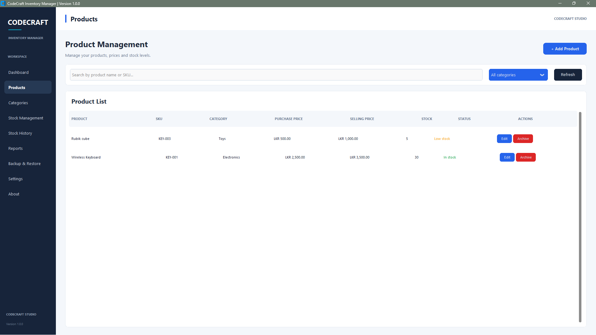
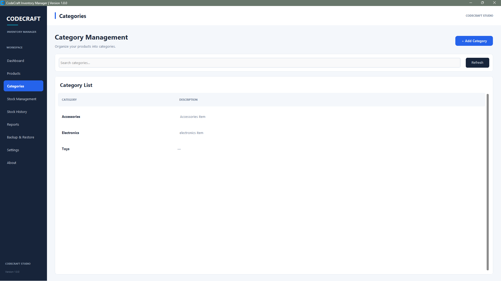
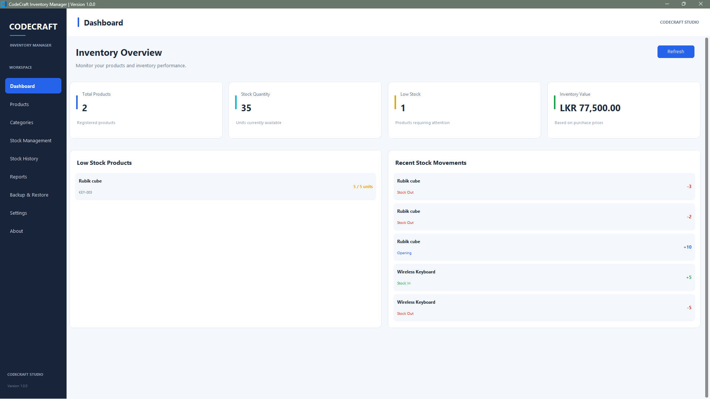
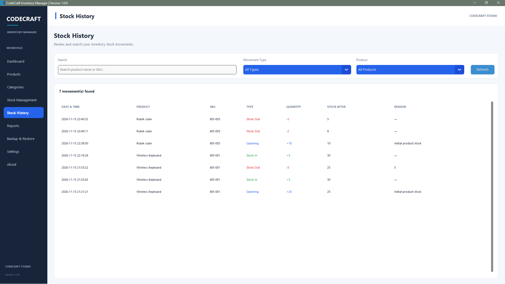
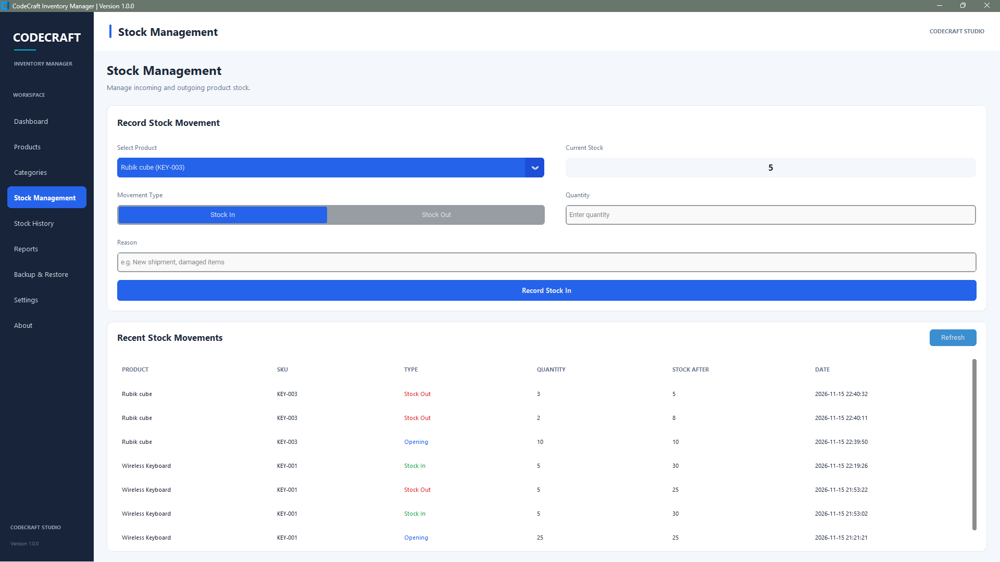
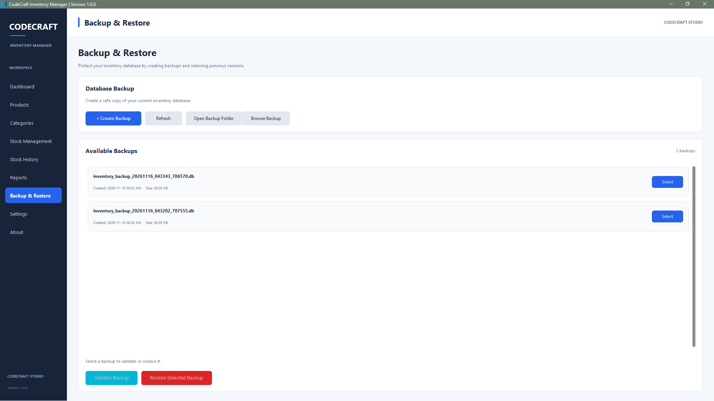
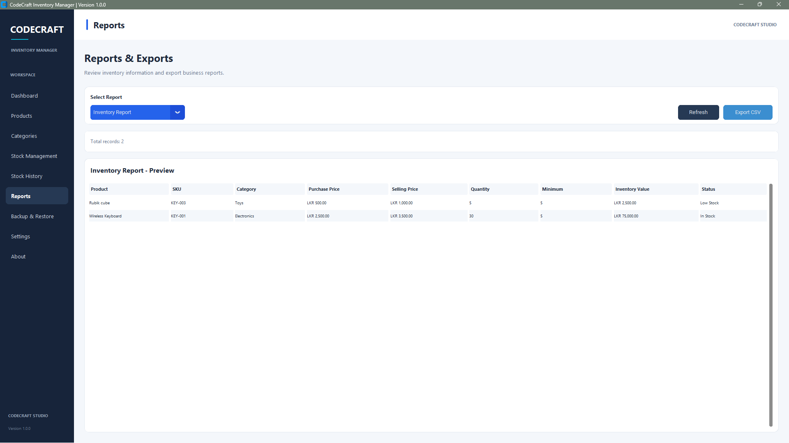
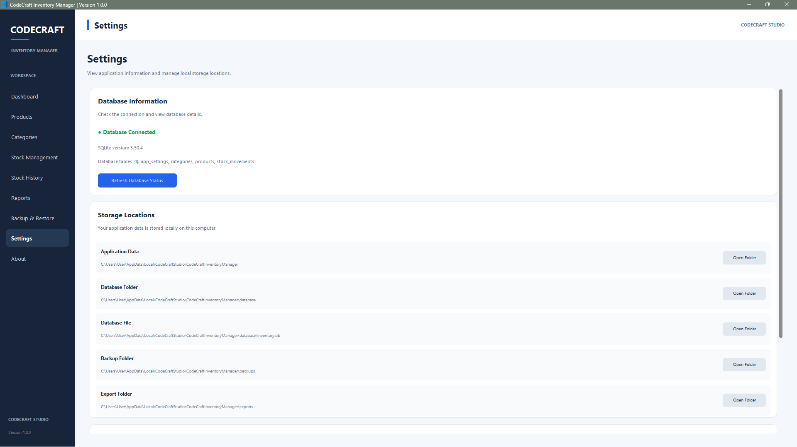

# CodeCraft Inventory Manager

A modern desktop inventory management application developed by CodeCraft Studio using Python, CustomTkinter, and SQLite.

## Overview

CodeCraft Inventory Manager helps small businesses manage products, stock levels, categories, inventory movements, and inventory reports through a clean desktop interface.

## Features

- Dashboard with inventory statistics
- Product creation, editing, searching, and archiving
- Category management
- Stock-in and stock-out operations
- Stock movement history
- Low-stock monitoring
- Inventory and stock movement reports
- CSV report exports
- Database backup and restore
- Input validation and error handling
- Local SQLite database storage

## Screenshots

### Dashboard


### Product Management


### Category Management


### Stock Management


### Stock History


### Reports


### Backup and Restore


### Settings


### About


## Technology Stack

- Python 3.14
- CustomTkinter
- SQLite
- Pillow
- Pytest

## Project Structure

```text
CodeCraftInventoryManager/
├── app/
│   ├── models/
│   ├── services/
│   ├── ui/
│   │   ├── components/
│   │   └── pages/
│   └── utils/
├── assets/
├── database/
├── exports/
├── backups/
├── tests/
├── main.py
├── requirements.txt
└── README.md
```

## Installation

### 1. Clone the repository

```bash
git clone YOUR_GITHUB_REPOSITORY_URL
cd CodeCraftInventoryManager
```

### 2. Create a virtual environment

```bash
python -m venv .venv
```

### 3. Activate the environment

Windows PowerShell:

```powershell
.venv\Scripts\Activate.ps1
```

### 4. Install dependencies

```bash
pip install -r requirements.txt
```

### 5. Run the application

```bash
python main.py
```

The application initializes its SQLite database automatically.

## Database and Data Storage

Application data is stored locally in the Windows user application-data directory:

```text
%LOCALAPPDATA%\CodeCraftStudio\CodeCraftInventoryManager\
```

The directory contains the database, backups, and exported reports.

## Testing

The project includes automated tests using Pytest.

Run the test suite:

```bash
python -m pytest -v
```

Current test result:

**61 tests passed.**

Additional manual acceptance checks were also completed successfully.

## Important Notes

- This is a local desktop application using SQLite.
- It is not currently a cloud-based or multi-user inventory platform.
- An executable installer and clean installation test are planned separately.

## Developer

**CodeCraft Studio**

Project: CodeCraft Inventory Manager  
Version: 1.0.0

---

Developed as a Python desktop application project.
